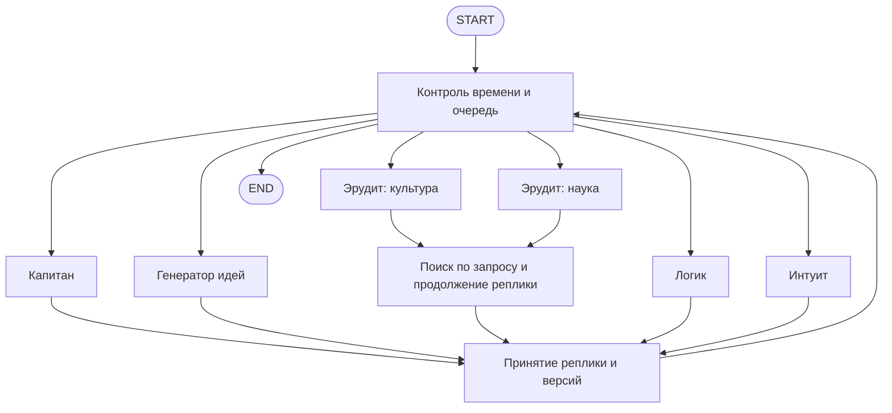

# Минута · команда ЧГК

Шесть игроков на LangGraph обсуждают текстовый вопрос ЧГК. Каждый игрок вызывает GigaChat через `langchain-gigachat` со своей ролью и тематическим профилем, получает уже прозвучавшие реплики и реагирует на версии других игроков. Веб-интерфейс написан на NiceGUI: Python-компоненты показывают команду, последовательные реплики, версии, источники, таймер и финальный ответ.

## Быстрый запуск

Нужны Python 3.13 и [uv](https://docs.astral.sh/uv/).

```sh
uv sync --locked
uv run chgk-serve --mode demo
```

Откройте **http://127.0.0.1:8000** и нажмите «Попробовать пример». Также работает `uv run python main.py --mode demo`. Для другого порта: `--port 8001`.

**Demo работает без ключей и интернета.** Это заранее заданный сценарий про маятник Фуко, который показывает взаимодействие, поиск, отсечение версии и делегирование. Ответ demo не зависит от введённого вопроса. Режим обозначен в интерфейсе и экспорте; его результаты нельзя считать точностью модели.

## GigaChat

Создайте локальный `.env` по образцу `.env.example`. Секреты остаются на сервере; `.env` исключён из Git.

```dotenv
CHGK_MODE=real
CHGK_GIGACHAT_CREDENTIALS=ваши_credentials
CHGK_GIGACHAT_SCOPE=GIGACHAT_API_PERS
CHGK_MODEL=GigaChat-2
CHGK_SEARCH_ENABLED=true
```

Credentials — поле «Авторизационные данные» из вашего кабинета GigaChat: Base64 от `client_id:client_secret`, без префикса `Basic `. Отдельный client secret для этой настройки не подходит. Scope и доступная модель зависят от вашего аккаунта; для корпоративного доступа укажите свой scope. Затем:

```sh
uv run chgk-serve --mode real
```

Без credentials страница открывается, а запуск реальной сессии возвращает понятную ошибку. Вызовы расходуют квоту провайдера. Проверка TLS включена по умолчанию; доверенный PEM-файл можно указать через `CHGK_CA_BUNDLE`. Настройка `GIGACHAT__VERIFY_SSL=false` отключает проверку сертификатов у клиента GigaChat; также поддерживается `CHGK_VERIFY_SSL=false`. Если оба имени заданы в одном источнике настроек, приоритет у `CHGK_VERIFY_SSL`. При отключённой проверке CA bundle не используется.

Дополнительные настройки: `CHGK_MAX_ACTIVE_SESSIONS=4`, `CHGK_MAX_SAVED_SESSIONS=32`, `CHGK_SESSION_TTL=1800`, `CHGK_MODEL_CONCURRENCY=2`, `CHGK_TURN_TIMEOUT=6`, `CHGK_MAX_TURNS=24`, `CHGK_CONTEXT_TOKENS=32000`, `CHGK_OUTPUT_TOKENS=1000`. Значение окна контекста должно соответствовать выбранной модели; локальная оценка числа токенов консервативна. В demo скорость реплик задаёт `CHGK_DEMO_DELAY=1.6`.

## Как устроено обсуждение



`StateGraph` содержит шесть отдельных узлов игроков. Начинает капитан: фиксирует условия вопроса, предлагает до двух следующих игроков, поддерживает или отклоняет версии и назначает отвечающего. После двух обычных ходов капитан получает новую возможность направить обсуждение. Код проверяет очередность, выбирает резервного игрока при некорректном решении и ограничивает повторные ходы.

| Игрок | Роль | Сильные темы | Слабые темы |
|---|---|---|---|
| Александр | Капитан | Формулировки, организация | Узкая техника |
| Ника | Генератор идей | Поп-культура, метафоры, язык | Точные даты, наука |
| Михаил | Эрудит | История, литература, искусство | Техника, спорт |
| Софья | Эрудит | Наука, техника, география | Искусство, цитаты |
| Даниил | Логик | Логика, математика, структура вопроса | Искусство |
| Ася | Интуит | Образы, наблюдения, игра слов | Хронология, доказательства |

У каждого вызова собственный системный промпт и полный принятый контекст сессии: вопрос, реплики, версии, возражения, источники и указания капитана. Одна и та же модель может обслуживать всех игроков; агентность здесь — в отдельных узлах, вызовах и решениях. Слабые темы побуждают обозначать сомнение, без намеренного внесения ложных фактов.

GigaChat возвращает структурированный ответ через `with_structured_output(..., method="function_calling")` в langchain-gigachat. Вывод модели проверяется по Pydantic-контракту. Только капитан имеет право отсекать версии и делегировать ответ; только эрудиты — искать факты. Неизвестные ссылки, превышенные размеры и неверный JSON не меняют версии. Реплики ограничены 350 символами, обычные ходы — 24, версии — 12. Поддержка версии капитаном не доказывает её правильность.

Публичные реплики, версии и обоснования содержат естественную речь. Очередь, назначение отвечающего и готовность передаются отдельными полями; капитан может обращаться к игрокам по именам. Явные сериализованные поля и служебные сводки внутри публичного текста отклоняются как невалидный ответ модели.

## Минута, поиск и восстановление

Отсчёт начинается при принятии сессии сервером. **50 секунд отводится обсуждению, последние 10 — финальному ответу** капитана или назначенного игрока. Капитан может завершить обсуждение раньше при готовом решении. Ожидание модели, поиска и семафора входит в бюджет. Сервер использует монотонные часы и отдельный контроль дедлайна; браузер показывает время по серверным отметкам.

На границе финализации ожидание обычного хода прекращается, а поздние результаты отбрасываются. Если финальная модель не успела или вернула ошибку, интерфейс показывает отсутствие окончательного ответа и отдельно последнюю ведущую версию. Локальная отмена не гарантирует прекращения уже начатого запроса на сервере провайдера и его биллинга. Доставка события браузеру дополнительно зависит от сети.

Эрудиты могут по конкретному запросу проверить факт через бесплатный публичный Wikipedia/MediaWiki API. До двух поисков на игру, максимум три результата, таймаут три секунды; после 45 секунд новые поиски запрещены. Поиск ограничен энциклопедией и не покрывает весь интернет. Сбой источника оставляет команде возможность обсуждать по памяти. В demo источники учебные и сеть не используется. Отключение: `CHGK_SEARCH_ENABLED=false`.

NiceGUI передаёт изменения Python-компонентов через своё штатное соединение WebSocket. Страница читает принятый серверный снимок; `app.storage.tab` сохраняет идентификатор игры при перезагрузке вкладки. Переподключение не запускает граф повторно и не дублирует реплики. Таймер вычисляется на сервере и не зависит от смещения часов браузера. Закрытие страницы не останавливает серверную игру. Идентификатор в volatile-хранилище NiceGUI относится к текущей вкладке; после закрытия вкладки автоматическое восстановление не гарантируется. JSON API и SSE остаются для внешних клиентов и проверок. После завершения можно сохранить JSON с вопросом, ролями, репликами, версиями, источниками и задержками.

Сессии хранятся в памяти одного процесса, до 30 минут после завершения. При заполнении сохранённой ёмкости удаляется самая старая завершённая игра. Перезапуск процесса теряет сессии; экспорт сохраняется у пользователя. Сервер запускается локально одним worker; публичное размещение и распределённое хранение требуют отдельной доработки.

## Проверки и оценка ответов

```sh
uv run pytest -q
uv run ruff check src tests
uv run ruff format --check src tests
```

Обычные тесты не обращаются к внешним сервисам. Для интерфейса используется штатный `nicegui.testing.user_simulation`: проверки запуска, экспорта, восстановления, ошибок и часов выполняются без браузера. Они проверяют роли, передачу истории, граф, ограничения поиска, изоляцию сессий, таймауты, поздние результаты, SSE и отсутствие эталонов в модельных запросах. Browser-тесты запускаются отдельно:

```sh
uv run playwright install chromium
CHGK_BROWSER_TESTS=1 uv run pytest -q tests/test_browser.py
```

Browser-прогон проверяет desktop/mobile, клавиатуру, обсуждение, источники, делегирование, экспорт, восстановление без дублей и безопасное отображение HTML. Скриншоты сохраняются в `artifacts/`.

```sh
uv run chgk-evaluate --mode demo --limit 2
uv run chgk-evaluate --mode real --questions eval/your-questions.jsonl --limit 10 --output artifacts/real-evaluation.json
```

Вторая команда делает реальные вызовы GigaChat. Формат набора и инструкция по подключению вопросов описаны в [eval/README.md](eval/README.md). Эталонные ответы получает только оценщик после завершения игры; агенты видят исключительно вопрос. Результат включает совпадения с допустимыми ответами, ошибки, отсутствие ответа, задержки, число реплик/вызовов и JSON обсуждений.

Автоматическая метрика — совпадение с допустимыми ответами после нормализации регистра, пробелов и ё/е. Эквивалентные формулировки проверяйте вручную. Зрелищность также проверяется отдельно: содержательность реплик, реакция на историю и различимость ролей. Правильность ответов на произвольные реальные вопросы не гарантируется; несколько агентов одной модели могут повторять одинаковую ошибку.

## Основные модули

- `agents.py`, `domain.py` — состав, ролевые промпты и контракты.
- `providers.py`, `search.py` — адаптеры GigaChat, MediaWiki и demo.
- `graph.py` — узлы игроков, очередь, принятие версий и контроль времени.
- `sessions.py`, `api.py` — сессии, события, восстановление, FastAPI и монтирование NiceGUI.
- `web.py`, `static/style.css` — компоненты NiceGUI и стили, без собственного JavaScript для игрового состояния и отдельной frontend-сборки.
- `evaluation.py`, `eval/` — оценка ответов и учебный набор.

Зафиксированный план: [simulate-chgk-team](openspec/changes/simulate-chgk-team/). Результаты проверки текущей версии: [docs/verification.md](docs/verification.md).
