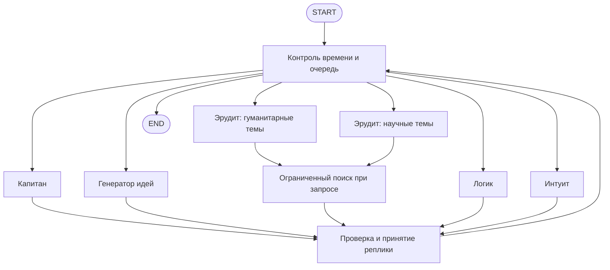

## Context

См. `proposal.md` для мотивации и `specs/*/spec.md` для поведения. Исходный проект — Python 3.13, без зависимостей, тестов и прикладного кода. Локальный `python3` сейчас имеет версию 3.12.6: реализация и проверка должны использовать окружение проекта на 3.13, а не менять требование незаметно. Состав из шести игроков с двумя эрудитами подтверждён пользователем.

## Goals / Non-Goals

**Goals:** явные узлы агентов в LangGraph; независимые ролевые обращения к GigaChat; единая память; последовательное видимое обсуждение; серверный дедлайн независимо от браузера; проверка поведения без внешних сервисов; отдельная оценка качества реальной модели.

**Non-Goals:** распределённый backend, сохранение и продолжение игры после перезапуска процесса, произвольный веб-краулинг, обработка картинок и аудио в вопросах, гарантированная точность ответов. Публичное размещение с аккаунтами и квотами — отдельная задача. В первой версии роли и темы задаются конфигурацией проекта, без редактора состава в интерфейсе.

## Decisions

### 1. NiceGUI поверх Python-сервиса

По указанию пользователя интерфейс создаётся компонентами NiceGUI: поле вопроса, кнопки, карточки игроков, лента реплик, версии, таймер и результат. NiceGUI монтируется через `ui.run_with` на FastAPI/Uvicorn. Предлагаемая структура: `src/chgk_team/{config,domain,agents,graph,providers,search,sessions,api,web,evaluation}.py`, `static/style.css`, `tests/`, `eval/`. Версии фиксируются в окружении Python 3.13.

NiceGUI выбран пользователем на основании собственного опыта тестирования. Состояние игры остаётся в серверном реестре; страница не запускает граф повторно при обновлении. Короткий `ui.timer` читает принятый снимок и обновляет компоненты через штатное соединение NiceGUI. При разрыве соединения выполняется стандартное переподключение; после перезагрузки вкладки идентификатор берётся из volatile `app.storage.tab` и отрисовывается текущий снимок. Потеря вкладки или перезапуск процесса не останавливает уже начатую серверную минуту, но после перезапуска сессия недоступна.

Таймер в интерфейсе вычисляется по серверным монотонным часам: смещение часов браузера не влияет на отсчёт. NiceGUI доставляет обновления, номера событий остаются для API/SSE и проверки согласованности. Внешние JSON API и SSE сохраняются для экспорта и автоматических проверок; браузер не использует отдельный EventSource или самописный JavaScript для игрового состояния. Все внешние тексты выводятся через `ui.label`, ссылки допускают только полученные HTTPS-адреса Wikipedia; пользовательские данные не вставляются в raw HTML.

### 2. Шесть узлов игроков и контролируемый маршрутизатор

Используется `StateGraph` с условными переходами, а не один промпт, изображающий сразу всех игроков. Каждый узел вызывает адаптер LangChain `GigaChat` с отдельным системным промптом и профилем. Одна модель провайдера допустима для всех: независимость состоит в разных вызовах, ролях и решениях, а не в шести обученных весах. Клиенты могут разделять транспорт и авторизацию, но не изменяемую историю сообщений.

Первый ход капитанский. Капитан предлагает очередь максимум из двух следующих игроков и отвечающего; маршрутизатор проверяет идентификаторы и ограничения. После двух обычных ходов капитан получает возможность корректировки. Резервная очередь сначала выбирает ещё не выступавших, затем наиболее давно выступавшего игрока; обычный игрок не получает более двух ходов подряд. Сильные темы служат подсказкой капитану, а не недоказанным автоматическим классификатором. При медленной модели участие всех шести за минуту не гарантируется.

Всего не более 24 обычных ходов; прекращение раньше минуты разрешено при явно принятом решении капитана. Если лимит ходов достигнут раньше 50 секунд без готового решения, новые вызовы прекращаются, а сессия ждёт плановой финализации. Пустая очередь запускает резервный выбор. Управление временем и ограничениями всегда в коде: указание модели не может их отменить.

### 3. Профили и публичные реплики

| Игрок | Функция | Сильные темы | Слабые темы |
|---|---|---|---|
| Капитан | Условия вопроса, направления, отбор версий | Формулировки, организация обсуждения | Узкие технические детали |
| Генератор идей | Ассоциации и несколько новых направлений | Поп-культура, язык, метафоры | Точные даты, специальные научные факты |
| Эрудит-гуманитарий | Факты и культурные связи | История, литература, искусство | Современная техника, спорт |
| Эрудит-естественник | Факты и научные объяснения | Наука, техника, география | Искусство, литературные цитаты |
| Логик | Ограничения, противоречия, ключевые слова | Логика, математика, структура вопроса | Узкая культурная эрудиция |
| Интуит | Образная связь и неожиданный кандидат | Бытовые наблюдения, образы, игра слов | Хронология, строгие доказательства |

Узлы получают исходный вопрос, всю принятую историю, версии и указания капитана. Промпт просит короткую реплику до 350 символов: добавить версию, конкретную ассоциацию, аргумент или возражение; при слабом знании обозначить сомнение. Это публичная игровая реплика с кратким обоснованием, без запроса полного скрытого рассуждения модели. Имена и тон различимы, но театральная болтовня не заменяет работу над вопросом. Реплики могут возвращаться к старой версии с новым аргументом.

Публичная речь отделяется от управления графом: капитан обращается к коллегам по именам, а ID очереди, отвечающего и сигнал готовности заполняет в отдельных аргументах функции. Контекст состава содержит имена вместе с ID. Схема передаётся штатным function calling и не дублируется полным JSON в системном промпте; описания её полей поясняют назначение публичной речи и служебных значений. Общий валидатор публичных текстов отклоняет явные сериализованные поля, служебные списки ID и булевы сводки в репликах, версиях, причинах и финальном ответе. Отклонение сохраняет исходное содержание: код не вырезает части модельного ответа и не переписывает старые экспорты.

### 4. Типизированный контракт и общая память

Pydantic описывает профиль, `Utterance`, `Hypothesis`, `Source`, `AgentReply`, `FinalAnswer` и события. Состояние графа содержит `session_id`, вопрос, режим, фазу, принятые реплики, версии, очередь, выбранного отвечающего, счётчики ходов/поиска, дедлайны и номер поколения исполнения.

Ответ игрока содержит `utterance`, необязательные изменения версий, ссылки на существующие версии/источники и запрос поиска только для эрудита. Капитану доступны также очередь, ведущая версия, делегирование и сигнал готового ответа. Проверяется не только JSON, но и права роли, длины, действительные идентификаторы. Новым версиям код присваивает идентификаторы; на ход максимум две новые версии, в сессии максимум 12. При заполненном лимите разрешено обсуждать существующие версии. Отклонённые версии остаются в памяти, новый аргумент может позволить капитану пересмотреть решение.

Модель не назначает себе полномочия и не пишет состояние напрямую. Только `commit` атомарно принимает проверенный результат и публикует согласованные изменения. Реальный адаптер использует штатный `with_structured_output(..., method="function_calling")` выбранной версии langchain-gigachat с отдельными схемами обычной реплики и финального ответа. Полученная Pydantic-модель сериализуется в JSON и повторно проверяется графом вместе с полномочиями роли. Одна инструкция вернуть JSON в промпте оказалась недостаточной в реальном smoke: обычные ответы были текстовыми. Невалидный ответ пропускает ход, без бесконечного исправления через модель. Максимальный контекст ограничен длиной вопроса, 24 репликами, 12 версиями и короткими источниками; суммарный размер дополнительно проверяется до вызова с учётом контекстного окна выбранной модели. При превышении лимита сокращаются служебные данные и фрагменты источников, а не принятые реплики; если контекст всё ещё не помещается, возвращается явная ошибка.

### 5. Минута и финализация

`started_at` и `deadline_at` передаются браузеру в UTC; ограничения сервера вычисляются по монотонным часам. Первые 50 секунд — обсуждение, последние 10 — финализация. Это выбранное толкование минуты, записанное в спецификации. Отдельный watchdog обеспечивает переход, даже если граф ждёт модель. Обычный ход имеет общий бюджет до 6 секунд, включая возможный поиск; лимит каждой операции обрезается до границы фазы. Ожидание общего семафора провайдера также расходует этот бюджет.

В 50 секунд watchdog атомарно меняет фазу и поколение исполнения, отменяет ожидание текущего хода и начинает граф с принятого снимка в режиме финализации. `control` направляет один финальный вызов в узел назначенного отвечающего, по умолчанию капитана. Ему передаются все принятые версии и решение капитана; новый поиск запрещён. Дополнительный вызов капитана перед делегатом не нужен: назначение сохранено ранее. Раннее завершение использует тот же механизм.

В 60 секунд состояние фиксируется как завершённое, даже если ответ не получен. Если финальная модель не успела, показывается отсутствие окончательного ответа и отдельно предварительная ведущая версия. Единственный финальный результат и событие завершения защищены блокировкой и проверкой поколения. Поздние результаты отменённого исполнения не допускаются к `commit`. Удалённый сервер провайдера может продолжить уже начатый запрос после локальной отмены; нельзя обещать отмену биллинга.

Полностью детерминированные ограничения проверяются с подставными часами и провайдерами. Жёсткий дедлайн означает прекращение принятия результатов; время доставки последнего события браузеру дополнительно зависит от сети и планирования ОС.

### 6. Поиск по запросу эрудита

Адаптер HTTPX вызывает фиксированный HTTPS endpoint русской Wikipedia/MediaWiki API: поиск и получение коротких текстовых фрагментов. Единицей лимита считается один запрос игрока, даже если адаптеру нужны две HTTP-операции; общий таймаут — три секунды. Максимум два поиска и три источника за поиск, фрагмент до 600 символов. Новые поиски после 45 секунд запрещены. Переходы HTTP на произвольные адреса отключаются.

Если первый ответ эрудита запросил поиск, результаты передаются тому же эрудиту для одного дополнительного вызова в оставшемся бюджете хода. Вторая просьба о поиске в этом ходе запрещена. Публикуется одна итоговая реплика; поиск виден отдельным статусом. Источники сохраняются с идентификаторами, ссылками и признаком получения; проверка позволяет ссылаться только на эти идентификаторы. Факт из Wikipedia не считается автоматическим доказательством всей версии.

Это бесплатный поиск по энциклопедии, а не обещание полноценного поиска всего интернета. Альтернатива DuckDuckGo без официальных гарантий стабильного бесплатного API не выбрана для основы. Provider-интерфейс позволит заменить источник позже. При ошибке эрудит продолжает без найденного подтверждения; содержимое источника передаётся как недоверенные данные.

### 7. Сессии, API и события

В первой версии состояние и события живут в памяти одного процесса. Не более четырёх активных сессий, двух одновременных вызовов модели и 32 сохранённых сессий; завершённые удаляются через 30 минут либо по очереди старости при заполнении. Лимиты настраиваются. Новый запуск при заполненной активной ёмкости получает 429 до создания графа. Перезапуск процесса теряет сессии; SQLite/checkpointer не требуется без функции возобновления.

API: `GET /api/team`, `POST /api/sessions` с вопросом, `GET /api/sessions/{id}` со снимком, `GET /api/sessions/{id}/events` для SSE и `GET /api/sessions/{id}/export`. Идентификатор сессии случайный. POST возвращает 201 с идентификатором и временами, ошибки ввода — 422, неизвестная/удалённая сессия — 404, отсутствие настроек реального режима — 503. Локальный сервер запускается на `127.0.0.1` одним worker.

События: `session_started`, `speaker_started`, `search_started`, `search_finished`, `utterance`, `hypotheses_updated`, `phase_changed`, `turn_failed`, `session_finished`. Каждое имеет номер, идентификатор сессии, серверное время и данные. Принятая история является источником истины. Внешний SSE-клиент применяет события один раз по номеру; Last-Event-ID восстанавливает пропущенные события. Страница NiceGUI читает серверный снимок и обновляет компоненты без дублирования реплик. Снимок содержит последний номер для согласованного восстановления; соединение сначала воспроизводит историю, затем подписывается без промежутка, под блокировкой. SSE heartbeat не меняет состояние игры. До 512 сохранённых событий на сессию достаточно для установленных лимитов; при устаревшем курсоре отправляется полный снимок с текущим номером. Медленный клиент отсоединяется при заполнении своей очереди и восстанавливается через снимок.

Обрыв браузера не отменяет граф. Все клиенты наблюдают одну серверную сессию. JSON-экспорт включает режим, конфигурацию модели без секретов, версии промптов, времена и задержки; системные настройки авторизации и токены не экспортируются.

### 8. Адаптеры, демонстрация и оценка

Настройки читаются из окружения: режим `real`/`demo`, серверные credentials/scope, модель, лимиты и включение поиска. Секреты не попадают в логи, DOM или JSON. Проверка TLS включена по умолчанию; при необходимости используется явно настроенный доверенный CA. По указанию пользователя поддерживаются `GIGACHAT__VERIFY_SSL=false` и `CHGK_VERIFY_SSL=false`, отключающие проверку сертификатов только клиента GigaChat; при этом CA bundle не передаётся. Если оба имени заданы в одном источнике, приоритет у `CHGK_VERIFY_SSL`. Перед кодированием адаптера проверяется фактический асинхронный интерфейс выбранных версий langchain-gigachat и LangGraph; версии фиксируются после проверки на Python 3.13.

Демонстрационный провайдер выдаёт заранее определённые реплики и решения для проверки UI, очередности, делегирования и таймера. Он не предназначен для правильного ответа на произвольный вопрос и маркируется везде. Обычные тесты работают без сети; реальный GigaChat запускается отдельной opt-in командой при наличии ключей.

Оценка читает JSONL: `id`, `question`, `answer`, `accepted_answers`, при наличии `source` и право использования. Только `question` передаётся сессии. Сопоставление нормализует регистр, пробелы и ё/е, но не использует ненадёжное автоматическое семантическое судейство как истину. Отчёт включает точное совпадение с допустимыми ответами, отсутствие ответа, ошибку, задержки, число вызовов/реплик и ссылки на экспорт; спорные формулировки можно пересмотреть вручную. Дополнительно вручную оцениваются содержательность реплик, реакция на историю и различимость ролей. Встроенные тестовые вопросы имеют собственные тексты; реальные вопросы добавляются из разрешённого пользователем источника с атрибуцией. Массовое скачивание базы не входит в план.

## Risks / Trade-offs

- [Медленная GigaChat] → короткие ответы, бюджет на ход, отдельный финальный резерв; число содержательных реплик измеряется, участие всех игроков и правильность не гарантируются.
- [Одинаковая модель повторяет заблуждения] → разные профили, логик с обязанностью проверять условия, явные возражения, источники и оценка на известных вопросах. Это снижает риск, но не доказывает независимость знаний.
- [Модель игнорирует роль или возвращает неверный формат] → ролевые поля проверяются кодом, ошибки не меняют состояние; полезность реплик оценивается отдельно от контрактных тестов.
- [Источники содержат ошибки или инструкции] → происхождение отображается, текст ограничивается, полномочия остаются в коде; ссылки подтверждают факт, не правильность командного ответа.
- [Последовательность уменьшает число вызовов] → нужна для реакции на уже прозвучавшее и понятного зрителю порядка. Параллельные скрытые черновики добавят стоимость и устаревающий контекст, поэтому отложены.
- [In-memory хранение] → простая демонстрация и экспорт; после перезапуска возобновление недоступно и это явно объясняется в README.

## Migration Plan

Миграции данных нет. Реализация добавляет пакет, зависимости, тесты, компоненты NiceGUI, стили и документацию к заготовке; `main.py` становится совместимым локальным запуском приложения. Сначала проверяются адаптеры и граф с подставными провайдерами, затем API/UI в demo, после настройки ключей — ограниченный ручной smoke-прогон реальной модели. Полный benchmark запускается отдельно. Откат — возврат к предыдущей версии кода и lock-файла; пользовательские экспорты остаются обычными JSON-файлами.
